# cleanyourtv, my TV

My own build of the [cleanyourtv](https://github.com/Gathin23/cleanyourtv) launcher, made for one TV: a TCL
43S450G. It adds a Continue watching row and five home screens, switched on the TV with a Themes button, with no
computer needed.

This is a personal fork. Everything here was tested on that one TV, and it goes further than the upstream project
allows on purpose: more permissions, network access for one image server, and an APK over the size limit. All
three are explained below. For cleaning up your own TV, start with
[upstream's README](https://github.com/Gathin23/cleanyourtv#readme). This fork's code is on the `my-tv` branch.

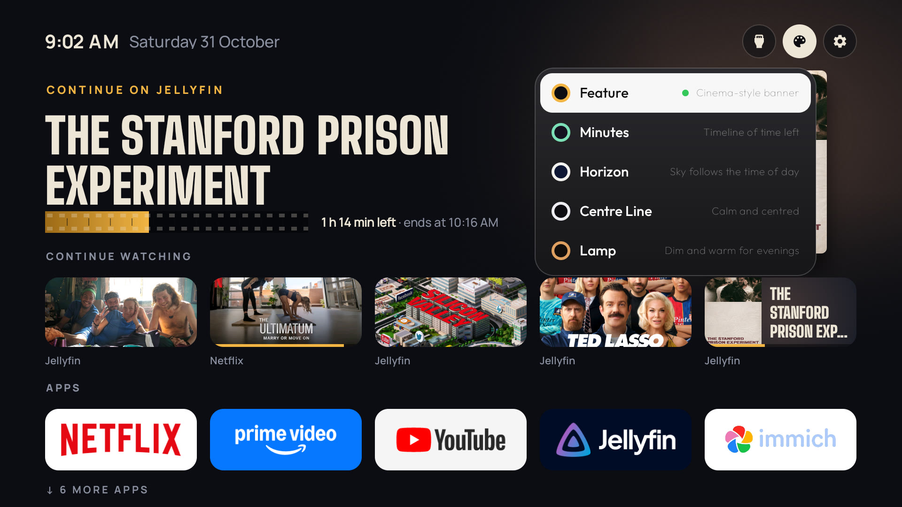

These are screenshots rather than videos because this TV's `screenrecord` captures only about one frame per key
press, even at 540p.

## The five themes

### Feature

A cinema-style banner of whatever is focused, with film-strip progress.

| A wide picture | A tall poster |
|---|---|
| 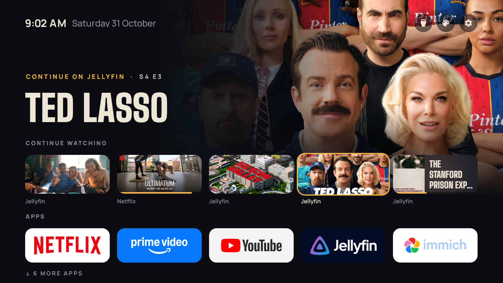 | 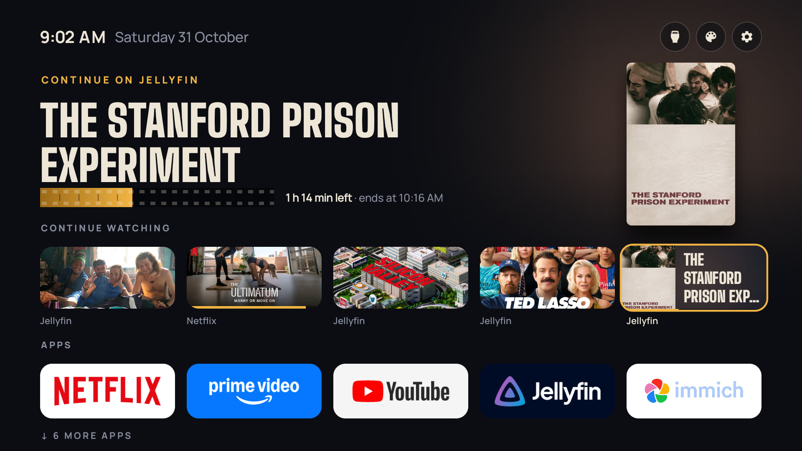 |

- **Progress is a strip of film.** It has sprocket holes along both edges, the watched part lit amber, and a frame
  line every 10 minutes of the running time.
- **Tall posters stay whole.** Jellyfin's 2:3 posters would crop badly across a wide banner, so they stand upright
  on the right, over a glow in their own colours.
- **The dock feeds the banner too.** A focused app shows its in-progress show, or the app over its own colour.
- **Home opens on the first show**, since picking up where you left off is the point of this screen.
- **Fonts:** Big Shoulders Display and Manrope. The tall, heavy title is most of the cinema feel.

### Minutes

Answers "what can I finish before bed?" with a timeline of time left.

| A show focused | An app focused |
|---|---|
| 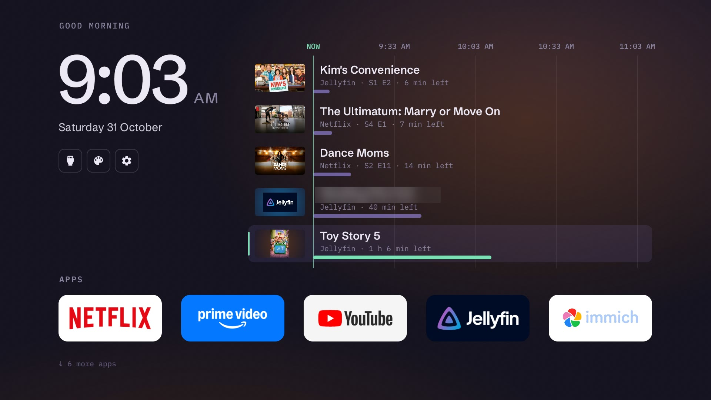 | 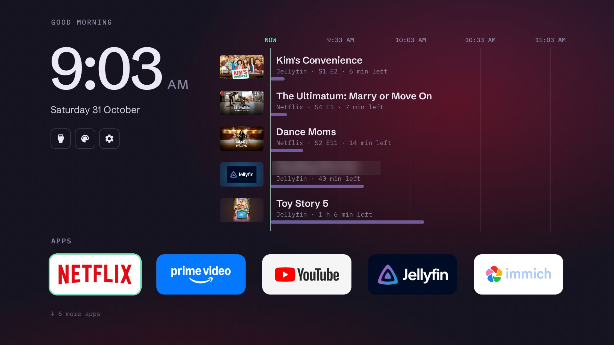 |

- **Shows are sorted shortest first**, and each bar ends at its finish time on a scale that starts at NOW. The time
  axis carries the "ends at" information, so there are no labels repeating it.
- **Next-episode rows are left out.** A show at 0% has no time left to compare.
- **The room takes the colour of what is focused**: a show's picture or an app's brand colour, fading over 0.8 s.
  Colours too grey to tint the room become the theme's lilac.
- **The gradient has grain painted over it**, because the GPU ignores dither and the dark violet banded without it.
- **Inputs, Themes and Settings sit under the date**, leaving the right side to the timeline. Left from any row
  reaches them.
- **Fonts:** Schibsted Grotesk and IBM Plex Mono. The monospace keeps the times lined up. IBM Plex has a Reserved
  Font Name, so the cut-down copy is named Minutes Mono, as its licence requires.

### Horizon

A sky that follows the time of day, with no setting to manage.

| Day | Dusk | Night |
|---|---|---|
| 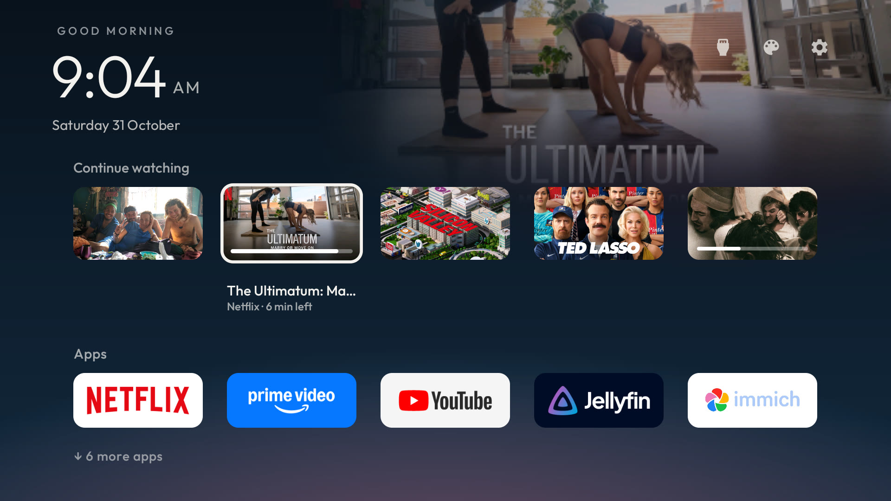 | 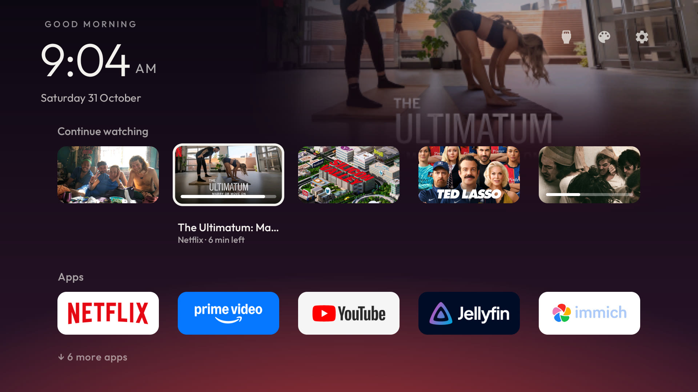 | 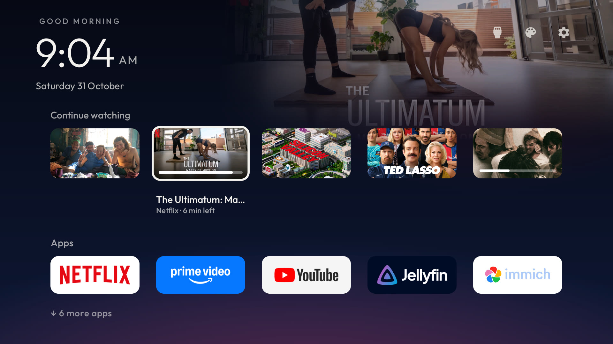 |

- **The clock drives the sky** through dawn, day, dusk and night, each fading in over its first hour. I tried a sky
  choice in the Themes list and decided against it.
- **The focused show fades into the sky** at the top right.
- **The horizon glows in the focused item's colour.**
- **Tall posters fill their cards**, cropped to the top, because Jellyfin's rows carry only the poster.
- **Font:** the launcher's bundled Outfit, so this theme added no font weight.

The dusk and night shots use a debug hour, so their clock still reads morning.

### Centre Line

Calm and symmetrical: a centred clock and very little else.

| A show focused | An app focused |
|---|---|
| 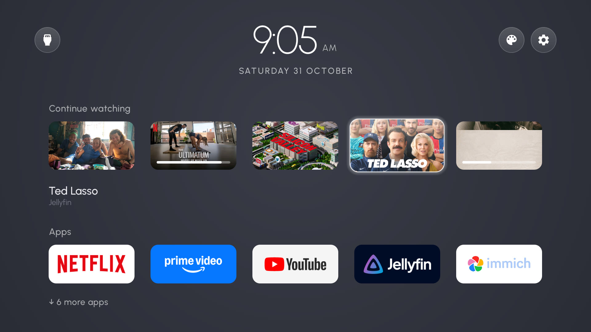 | 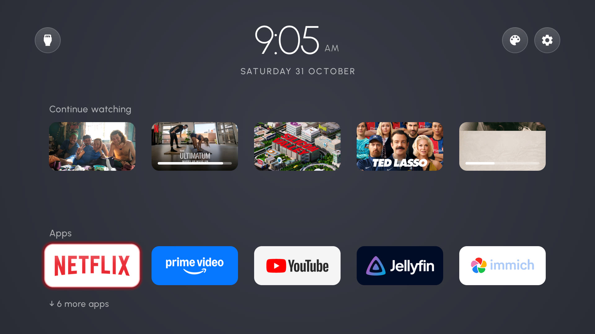 |

- **No dock band.** Tiles are a little shorter than the 16:9 show cards, and the labels have matching gaps.
- **The focused app gets a small soft glow** in its own colour, rather than a heavier highlight.
- **The room follows the sun.** The slate background darkens from 4 PM while up to 140 stars come out one by one.
  Full night runs from 9 PM to 5 AM, with dawn from 5 to 8. The stars aren't pictured, because the debug hour
  doesn't reach this theme.
- **Font:** Urbanist in weights 200 to 500, cut to Latin. The thin clock depends on it.

### Lamp

A dim, warm room where only the focused item is lit.

| Day | Evening | An app focused, evening |
|---|---|---|
| 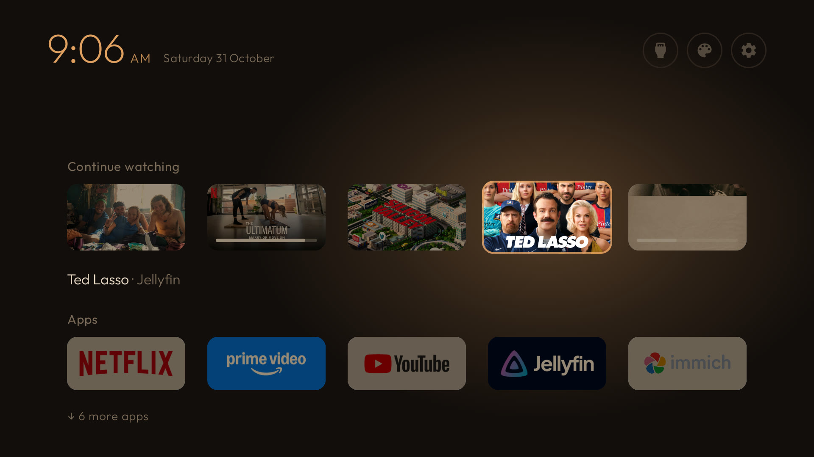 | 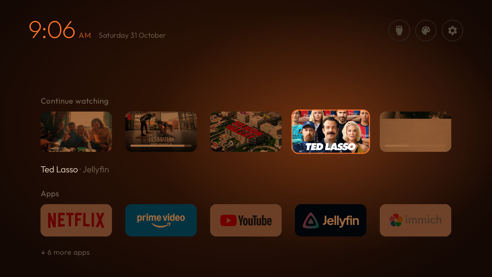 | 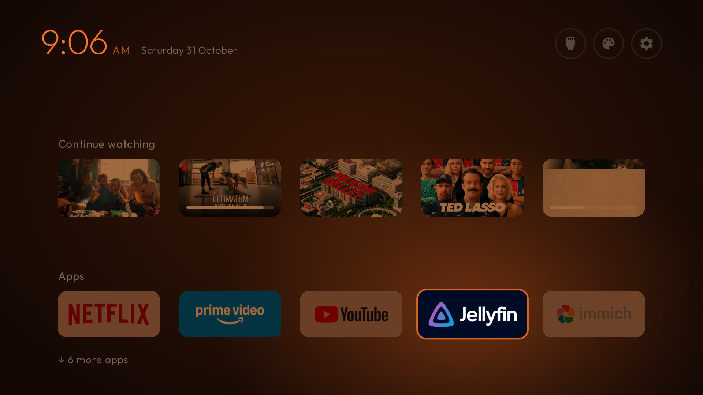 |

- **Everything unfocused is dimmed** with a multiply layer, and white tiles such as YouTube and Immich go further,
  like paper in shadow. Otherwise they would be the brightest things in the room.
- **The lamp is a soft amber glow that follows focus.** It replaces the launcher's glass highlight but reuses its
  spring motion, by following the hidden glass.
- **The evening turns to ember orange**: warming from 5 to 9 PM, full until 5 AM, and back by 8 AM. Background, dim
  tint, glow and clock all shift together.
- **Font:** the bundled Outfit, so this theme added no font weight.

The evening shots use a debug hour, so their clock still reads morning.

## What every theme shares

- **Continue watching:** a row built from Android TV's Watch Next, with old, finished, duplicate and watchlist rows
  filtered out. On this TV only Jellyfin and Netflix publish anything. Prime Video, YouTube and Disney+ don't.
- **Posters load on their own thread** into a cache, because Jellyfin's image provider is slow and used to leave
  the row empty.
- **Minimal chrome:** icon-only Inputs, Themes and Settings, no Wi-Fi pill, an "Apps" label over the dock, and a
  "more apps" hint with the rest of the grid below the fold.
- **The real remote works throughout:** the Netflix, YouTube, Prime, Input and Settings buttons all answer here
  instead of in the stock launcher.

## Why this is over the size limit

Upstream fails CI if the release APK reaches 589,824 B (576 KB), because its launcher targets TVs with 1 GB of RAM.
This build is **724,721 B, which is 134,897 B over**. The size went like this, measured by building each milestone:

| After adding | APK size (B) | Added (B) | Against the limit (B) |
|---|---:|---:|---:|
| Upstream, where I forked | 545,077 | | 44,747 under |
| Continue watching | 551,861 | 6,784 | 37,963 under |
| Themes button, Centre Line layout | 560,829 | 8,968 | 28,995 under |
| Urbanist for Centre Line | 586,825 | 25,996 | 2,999 under |
| Lamp | 590,677 | 3,852 | **853 over** |
| Horizon, Netflix posters | 595,469 | 4,792 | 5,645 over |
| Minutes | 676,065 | 80,596 | 86,241 over |
| Feature | 724,721 | 48,656 | 134,897 over |

Lamp is where it crossed the line, but only because Urbanist had used up nearly all the room. Fonts are the real
cause. Their compressed size in the APK:

| Theme | Fonts | Compressed (B) |
|---|---|---:|
| Minutes | Schibsted Grotesk, three weights of IBM Plex Mono | 71,104 |
| Feature | Manrope, Big Shoulders Display | 39,201 |
| Centre Line | Urbanist | 24,512 |
| Lamp, Horizon | none, they use the bundled Outfit | 0 |
| **Total** | | **134,817** |

That total is almost exactly the overage: five themes of code came in close to the limit, and the fonts are the
rest. I kept them because each theme's type is much of its character, and all of them are already cut down to
Latin characters and the weights in use. Dropping them would bring the APK back to about the limit.

The trade is fine for this build because it runs on one TV with 2 GB of RAM, and the limit is upstream's rule for
its own users. That's also why this stays a fork and these changes aren't offered upstream as a pull request.

## Permissions added

| Permission | Why | Scope |
|---|---|---|
| `READ_TV_LISTINGS` | To read Watch Next for Continue watching | Must be granted once with `pm grant`, as shown below |
| `INTERNET` | Netflix puts web addresses in Watch Next, so its posters must be downloaded | The `netflix_posters` switch. https to `nflxso.net` only, no redirects followed, cached on the TV so each picture downloads once |

Every other app's pictures stay local. The launcher has no analytics, and nothing else uses the network.

## New switches

All are off by default, like upstream's other switches. This TV turns them on with a theme overlay.

| Key | What it does |
|---|---|
| `continue_watching` | The Continue watching row |
| `themes_button` | The palette button and Themes list |
| `dock_labels` | The "Apps" label and "more apps" hint |
| `netflix_posters` | Netflix's posters, and the only network use |

They're documented with the other keys in [`themes/README.md`](../themes/README.md).

## The TV

| | |
|---|---|
| Model | TCL 43S450G, Realtek, 2 GB RAM |
| System | Google TV 11 (SDK 30) |
| Software | `V8-R51MT08-LF1V053` |

Upstream's [TCL G03 list](../examples/tcl-g03-google-tv/) is the closest match for this set. 27 packages are disabled,
all reversible. No root, and nothing uninstalled.

## Build and install

You need JDK 17 and Android SDK platform 34 (build-tools 34.0.0), plus ADB debugging on the TV. Read upstream's
[`PROMPT.md`](../PROMPT.md) and its safety rules before changing anything on a TV.

```bash
export TV_HOST=<tv ip>
STOCK_LAUNCHER=none INPUT_KEY_SERVICE=1 HOME_KEY_SERVICE=1 launcher/build-and-install.sh
tools/tv.py "pm grant com.gathin.tvhome android.permission.READ_TV_LISTINGS"
```

Pass both key-service flags every time, because a reinstall switches the remote-button helpers off. The Themes
button then appears once `themes_button` is on: push a theme with it set using `tools/theme.sh`.

The tests are `./gradlew --no-daemon testReleaseUnitTest lintRelease assembleRelease` in `launcher/`, and
`tools/venv/bin/python -m unittest discover -s tests` from the root.

## Credits

Built on [cleanyourtv](https://github.com/Gathin23/cleanyourtv) by Gathin23 and its contributors, under the MIT
licence. The bundled fonts are under the SIL Open Font License, with their licences in [`launcher/`](../launcher/).
Show titles and posters in the screenshots belong to their owners.
